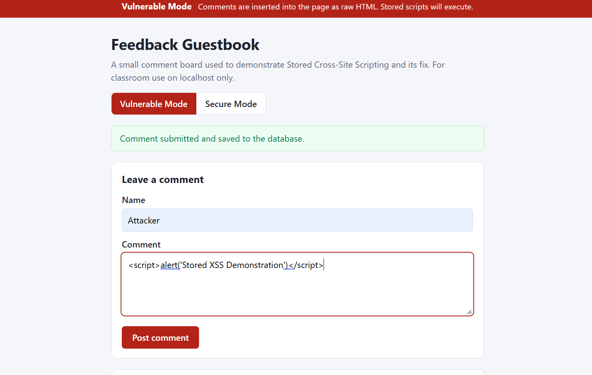
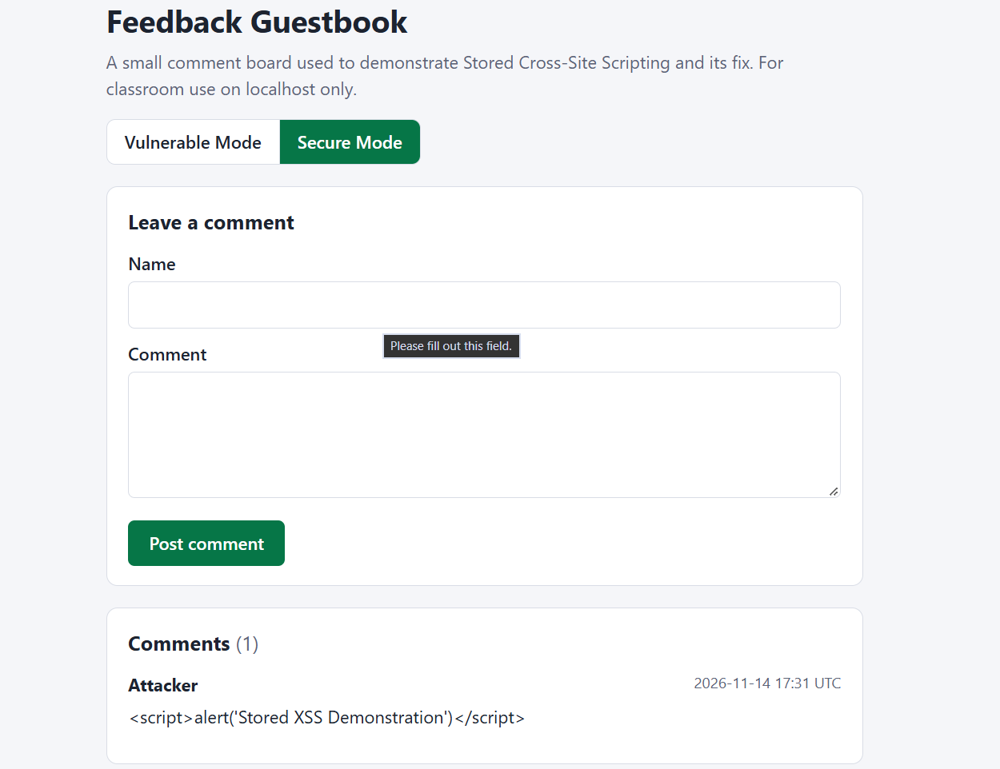
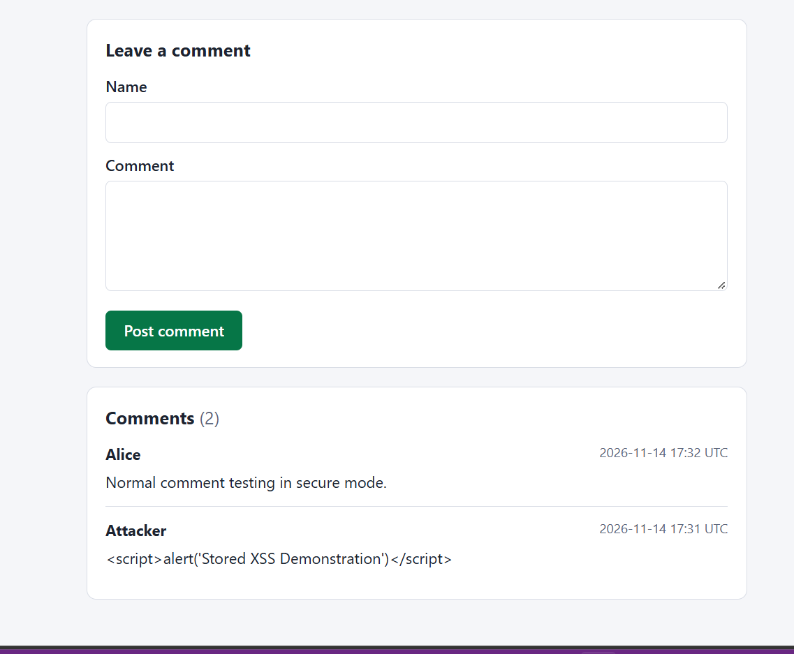
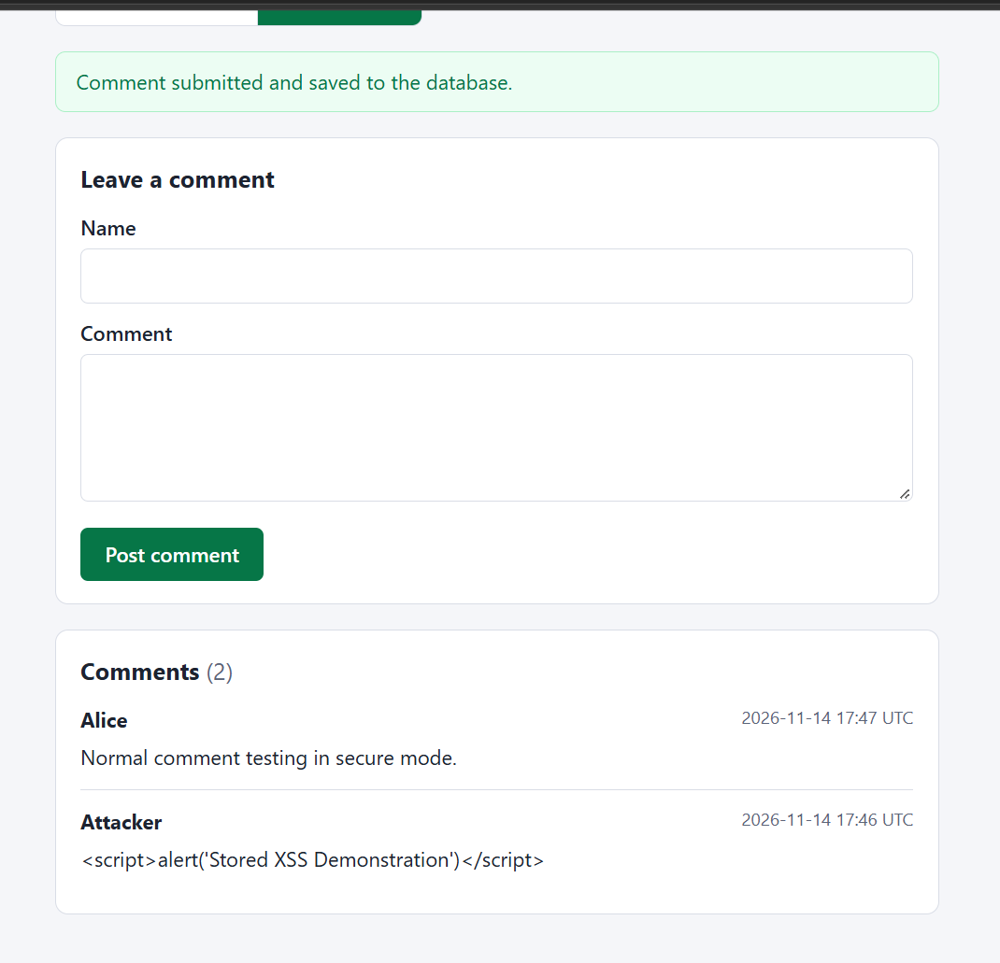

# Stored Cross-Site Scripting (Stored XSS)

| **Member** | **Roll number** | **Vulnerability category** | **Variant** |
|---|---|---|---|
| Surbhi Kumari Sah | IIT2024063 | Cross-Site Scripting (XSS) | Stored XSS |

## Run locally

### Prerequisites

- Node.js and npm
- MySQL Server 8.0 or later

### 1. Clone the repository

```bash
git clone https://github.com/Rushalverma/iiita-web-security-assignment-2026.git
cd iiita-web-security-assignment-2026/IIT2024063
```

### 2. Install dependencies

```bash
npm install
```

### 3. Configure the database

Ensure that MySQL Server is running and import the database schema:

```bash
mysql -u root -p < database/schema.sql
```

### 4. Configure environment variables

Copy `.env.example` to `.env` and configure your database credentials.

Example:

```env
DB_HOST=127.0.0.1
DB_PORT=3306
DB_USER=xss_app
DB_PASSWORD=your_database_password
DB_NAME=stored_xss_demo
PORT=3000
```

Do not commit `.env` or share database credentials.

### 5. Start the application

```bash
npm start
```

Open the application at:

**http://localhost:3000**

No preconfigured accounts are required. Users can submit comments through the application.

## Vulnerability and root cause

Stored Cross-Site Scripting (Stored XSS) occurs when an application stores untrusted user input and later displays it in a webpage without properly handling it.

This project implements a comment and feedback application where user-submitted comments are stored in a MySQL database and displayed on the webpage.

### Vulnerable implementation

- **Source file:** `views/vulnerableRenderer.js`
- **Related route:** `routes/comments.js`

The vulnerable renderer inserts stored comment content into HTML without appropriate output encoding.

An attacker can submit the following payload:

```html
<script>alert('Stored XSS Demonstration')</script>
```

The payload is stored in the database. When comments are rendered in Vulnerable Mode, the browser interprets and executes the injected JavaScript.

The malicious script can execute again when another user visits or refreshes the page.

### Root cause

The root cause is the unsafe handling of untrusted user input during HTML rendering.

Storing user input in a database does not make it safe. The application must encode untrusted content appropriately before rendering it in the browser.

## Implemented mitigation

**Mitigation: Context-aware output encoding**

- **Source file:** `views/secureRenderer.js`

The secure implementation applies context-aware output encoding before inserting user-generated content into HTML.

It uses separate encoding functions for:

- HTML text content.
- Quoted HTML attribute values.

Special characters are converted into their corresponding HTML entities so that user input is displayed as text instead of being interpreted as executable HTML or JavaScript.

### Verification of mitigation

The same malicious payload is tested in both application modes.

**Before mitigation – Vulnerable Mode:**
- The malicious JavaScript executes.
- An alert box appears.
- The payload executes again after refreshing the page.

**After mitigation – Secure Mode:**
- The malicious payload is displayed as ordinary text.
- No JavaScript alert is triggered.
- Previously stored malicious comments are also rendered safely.

Both modes use the same stored comments, allowing the vulnerable and secure behavior to be compared.

## Demonstration and evidence

The following screenshots document the application's vulnerable behavior, persistence, and implemented mitigation.

### 1. Stored XSS execution in Vulnerable Mode

The submitted JavaScript payload executes and displays an alert box.



### 2. XSS execution after page refresh

The previously stored malicious comment executes again after refreshing the page, demonstrating persistence.


### 3. Same payload in Secure Mode

The malicious payload is displayed as text instead of executing, demonstrating the effectiveness of context-aware output encoding.



### 4. Normal comment in Secure Mode

An ordinary comment is successfully submitted and displayed, demonstrating that the mitigation does not prevent normal application functionality.



### 5. Comment persistence after server restart

Previously submitted comments remain available after restarting the application because they are stored in the MySQL database.



## Other mitigations

The following are alternative or additional measures that help prevent or reduce the impact of XSS vulnerabilities.

### 1. Framework auto-escaping

Modern web frameworks automatically escape dynamic values in many HTML rendering contexts, helping prevent user input from being interpreted as executable markup.

### 2. HTML sanitization

When an application intentionally allows rich HTML content, an HTML sanitizer can remove dangerous elements, attributes, and scripts while preserving permitted formatting.

### 3. Content Security Policy (CSP)

CSP restricts which scripts and other resources the browser is allowed to execute or load. It provides an additional layer of protection if an injection vulnerability exists.

### 4. HttpOnly cookies

The HttpOnly cookie attribute prevents JavaScript from directly accessing cookies through browser scripting APIs. It helps reduce the risk of cookie theft through XSS but does not prevent XSS itself.

### 5. Safe DOM sinks

Using safe DOM APIs such as `textContent` instead of unsafe HTML insertion methods prevents user-provided strings from being interpreted as HTML.

### Relationship with the implemented mitigation

Context-aware output encoding directly addresses the root cause in this project by ensuring that untrusted input is treated as data rather than executable content.

The other measures provide additional protection or address specific rendering and browser-security risks.

## Verification

Run the automated test suite from the project directory:

```bash
node tests/run-tests.js
```

The test suite covers normal comment handling, multiple comments, stored XSS behavior in vulnerable rendering, secure rendering, special-character handling, and comment persistence.

The vulnerable and secure application behaviors were also manually demonstrated in the browser, as documented in the evidence section above.
