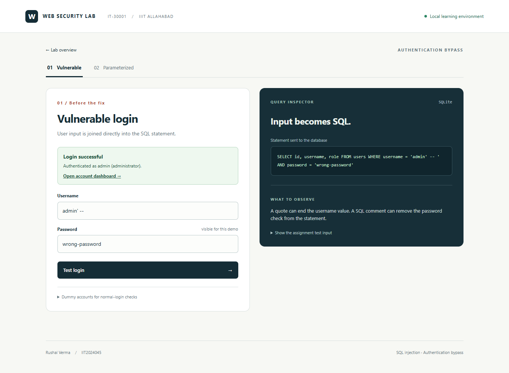
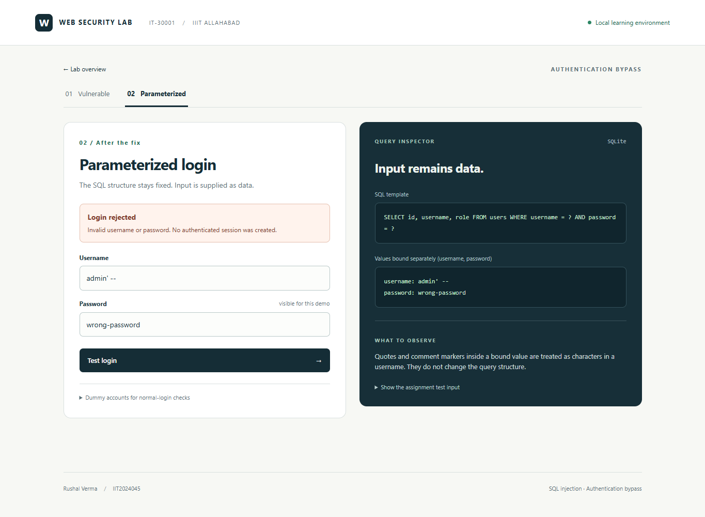

# Evidence

This folder holds screenshots captured from the actual running application. Filenames describe the test state:

| File | Expected content |
| --- | --- |
| `01-normal-rejected.png` | Vulnerable login rejects `admin` / `wrong-password`. |
| `02-bypass-success.png` | Vulnerable login accepts `admin' -- ` / `wrong-password`, displaying the query. |
| `03-protected-dashboard.png` | The bypass creates a session that can access the admin dashboard. |
| `04-same-payload-blocked.png` | Parameterized login rejects exactly the same attack inputs. |
| `05-valid-login-after-fix.png` | Parameterized login still accepts correct dummy credentials. |
| `06-mobile.png` | The login remains readable on a small screen. |

`walkthrough.webm`, when generated, is a **silent browser reference recording**, not a final narrated submission. It shows normal rejection, the successful bypass, protected content, the blocked retry, and valid login after the fix. The source-code explanation and Rushal's own narration must still be recorded for the submitted video. Video files are kept locally and excluded from Git; screenshots are included in the public repository.

## Before the fix: bypass succeeds



## After the fix: the exact same payload is rejected



To regenerate evidence, first run the Python app. In a separate terminal from the repository root, install the optional browser dependency and capture:

```powershell
npm install
npx playwright install chromium
npm run capture
```

The capture script connects only to a local loopback URL. Set `SQLI_LAB_URL` if you started the Python app on a different port. It checks the displayed outcomes and actual dashboard access before saving evidence. Existing evidence files with these names are replaced.

